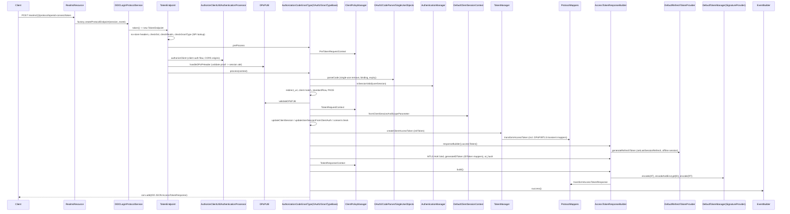

# Research: OIDC main flow, token issuance and sessions

**Date**: 2026-10-18T10:20:55+02:00
**Researcher**: Claude (Opus 5.5) for RemekGdansk
**Git Commit**: 2ab8a806bffc945d0f97a625860bc439b9a16b4e
**Branch**: context-map
**Repository**: RemekGdansk/keycloak-analysis

## Research Question

Analyse the main flow, token issuance and sessions, in `services/src/main/java/org/keycloak/protocol/oidc`. The work had three parts:

1. Trace token issuance end to end, from the entry point through every layer and side action to the returned token.
2. Find gaps in the automated tests.
3. Measure the blast radius: what has to change, or be re-verified, when token issuance logic changes.

The scope is the current state of the repository only, with no changes proposed for implementation. The report has two explicit sections, **Feature overview** and **Technical debt**, and keeps evidence, inference and unknowns apart.

### How to read this document

- **[E] Evidence**: read directly in the source at the cited `file:line`, or a count with the stated command.
- **[I] Inference**: a conclusion drawn from evidence. It is plausible but has not been executed or proven.
- **[U] Unknown**: not determined. The reason is given.

Path abbreviations:

| Abbreviation | Path |
|---|---|
| `S/` | `services/src/main/java/org/keycloak/` |
| `P/` | `S/protocol/oidc/` |
| `SPI/` | `server-spi-private/src/main/java/org/keycloak/` |
| `N/` | `tests/base/src/test/java/org/keycloak/tests/` (new framework) |
| `L/` | `testsuite/integration-arquillian/tests/base/src/test/java/org/keycloak/testsuite/` (legacy) |
| `U/` | `services/src/test/java/org/keycloak/` |

**Verification:** the first draft used only `grep`. Every structural claim (call-site counts, implementation counts, "only here", call shapes) was then re-checked with **ast-grep 0.51.0** (`/opt/homebrew/bin/ast-grep`), and every ast-grep zero was cross-checked with grep. Verdicts, patterns and corrections are in **§3 Structural verification**; the counts in §1–§2 are the corrected values. Message-string searches, such as `"Incorrect redirect_uri"`, are literal-text claims and stay grep-based.

## Summary

- **The flow.** A browser login creates the user session and the client session. The client session is built in `TokenManager.attachAuthenticationSession` (`P/TokenManager.java:510-560`). The login then stores a single-use code in `singleUseObjects` (`P/OIDCLoginProtocol.java:288-301`, `P/utils/OAuth2CodeParser.java:49-59`). Next, `POST /token` goes through `RealmsResource` → `OIDCLoginProtocolService` → `TokenEndpoint`, which picks a grant through SPI. `AuthorizationCodeGrantType` validates the code, the session, `redirect_uri`, PKCE and DPoP. `OAuth2GrantTypeBase.createTokenResponse` then asks `TokenManager` to build and map the tokens, and signs them through `session.tokens()` (`P/TokenManager.java:1492,1514,1518`). [E]
- **`TokenManager` is a concrete class of 1769 lines with no interface.** It is created with `new` at 11 sites in `services/src/main` [E, ast-grep]. It is unrelated to the JOSE `org.keycloak.models.TokenManager` SPI behind `session.tokens()` [E]. Refresh no longer lives in `TokenManager`: it moved to the `RefreshTokenProvider` SPI (`P/refresh/RefreshTokenProvider.java:52`) [E].
- **Tests.** There is effectively **no unit coverage**. `TokenManagerTest.java` is 62 lines with one `@Test`, which covers only `isValidScope` [E]. Refresh behaviour is well covered in `tests/base` [E]. Going by grep over the three test roots, four error paths of the **authorization-code exchange** are covered only by the legacy Arquillian suite: expired code, `redirect_uri` mismatch, PKCE, and an expired user session. Five branches have no test found by message search [E, grep-bounded].
- **Blast radius.** Changing `TokenManager` reaches 63 files [E]:
  - 10 grant types plus 3 refresh-token providers
  - 2 token-exchange providers
  - UMA
  - the admin "evaluate scopes" resource
  - account console, broker and `AuthenticationProcessor`
  - about 25 or more protocol mappers
  - 9 response-phase client-policy events
  - session adapters in 3 model modules

  Some coupling is hidden from the compiler: SPI lookups, and `tokenManager` typed as `Object` in the SPI contexts [E].

---

# 1. Feature overview

## 1.1 Phase A: browser authorization, where the sessions and the code are created

All steps below are [E]; each anchor was read.

| # | Anchor | What happens |
|---|---|---|
| A1 | `P/endpoints/AuthorizationEndpoint.java:138` | `process()` fires the client policy `PreAuthorizationRequestContext` (`:145`), creates the auth session (`:210`), then fires `AuthorizationRequestContext` (`:213`) |
| A2 | `P/endpoints/AuthorizationEndpoint.java:354,483,491` | Stores the issuer, `code_challenge`/method and `dpop_jkt` as client notes on the auth session |
| A3 | `S/authentication/AuthenticationProcessor.java:1238,1250` | Once the login flow is done (the flow itself was not traced), `authenticationComplete()` calls `AuthenticationManager.finishedRequiredActions` |
| A4 | `S/services/managers/AuthenticationManager.java:1132,1139` | Rejects a disabled user, then calls `AuthenticationProcessor.attachSession` |
| A5 | `S/authentication/AuthenticationProcessor.java:1161-1186` | Finds or creates the **user session** (`UserSessionManager.createUserSession`, `:1165`). Restarts an invalid one (`:1172`), errors on a different user (`:1179`), and sets the state to LOGGED_IN (`:1185`) |
| A6 | `S/authentication/AuthenticationProcessor.java:1198,1206` | Calls `TokenManager.attachAuthenticationSession` and sets or clears the `FIRST_OFFLINE_ACCESS` note (`:1201/1203`) |
| A7 | `P/TokenManager.java:510-560` | Builds the **client session**: reuse it, restart it if `isClientSessionValid` fails (`:516-518`), or create it (`:524`). Sets redirect and protocol (`:527-528`) and scopes (`:536-542`). Copies auth-session notes into the client session and the user session (`:544-552`). Sets LoA (`:554`) and the timestamp (`:555`). Removes the auth-session tab (`:557`) and returns `DefaultClientSessionContext` (`:559`) |
| A8 | `S/services/managers/AuthenticationManager.java:963-1006` | Removes an old SSO session (`:967-975`). Sets the login cookie (`:982`), remember-me (`:984-988`) and the `AUTH_TIME`/`SSO_AUTH` note (`:993-1001`). Runs `logSuccess` (`:1004`), then calls `protocol.authenticated(...)` (`:1006`) |
| A9 | `P/OIDCLoginProtocol.java:229-274` | Consumes the PAR `request_uri` once (`:236`). Adds `state`, `session_state` and `iss` to the redirect (`:258-271`) and sets the nonce (`:274`) |
| A10 | `P/OIDCLoginProtocol.java:288-301` → `P/utils/OAuth2CodeParser.java:49-59` | Builds an `OAuth2Code` (nonce, scope, redirect_uri, PKCE, dpop_jkt, session id) and stores it in `singleUseObjects` with a TTL of `accessCodeLifespan`. The code string is `<uuid>.<userSessionId>.<clientUUID>` (`:59`) |
| A11 | `P/OIDCLoginProtocol.java:305-361` | Implicit and hybrid flows only: tokens are issued here directly and `ImplicitHybridTokenResponse` fires (`:329`) |

## 1.2 Phase B: `POST /token` with `grant_type=authorization_code` (main path)

All steps below are [E]; each anchor was read.

| # | Anchor | What happens |
|---|---|---|
| B1 | `S/services/resources/RealmsResource.java:108-121` | `getProtocol()`: realm (`:111`), `LoginProtocolFactory` lookup (`:113`), `EventBuilder` (`:119`), `createProtocolEndpoint` (`:121`) |
| B2 | `P/OIDCLoginProtocolFactory.java:723-724`; `P/OIDCLoginProtocolService.java:84,177-179` | The service creates `new TokenManager()` (`:84`). `@Path("token")` returns `new TokenEndpoint(session, tokenManager, event)` |
| B3 | `P/endpoints/TokenEndpoint.java:130-142` | `processGrantRequest()` gets `Cors.builder()` (SPI), sanitizes the form, and sets `Cache-Control: no-store` and `Pragma: no-cache` |
| B4 | `P/endpoints/TokenEndpoint.java:145-146,205-213` | `checkSsl`, `checkRealm` |
| B5 | `P/endpoints/TokenEndpoint.java:237-248` | `checkGrantType`: `session.getProvider(OAuth2GrantType.class, grantType)` (`:242`), sets event type `CODE_TO_TOKEN` |
| B6 | `P/endpoints/TokenEndpoint.java:149` → `P/grants/AuthorizationCodeGrantType.java:72-73` | `preProcess` fires the client policy `PreTokenRequestContext` |
| B7 | `P/endpoints/TokenEndpoint.java:161,217-235` → `P/utils/AuthorizeClientUtil.java:48-87` | **Client authentication**: `AuthenticationProcessor.authenticateClient()` (`S/authentication/AuthenticationProcessor.java:965`). Checks the client is enabled, CORS origins, protocol = OIDC, not bearer-only. Logs the full-scope warning |
| B8 | `P/endpoints/TokenEndpoint.java:162,166,276-295` | Checks for duplicated parameters and OIDC parameter size limits |
| B9 | `P/endpoints/TokenEndpoint.java:174` → `S/services/util/DPoPUtil.java:146-171` | When the feature is on: validates the DPoP proof and stores it as a session attribute (`:165`) |
| B10 | `P/endpoints/TokenEndpoint.java:176-188` | Builds `OAuth2GrantType.Context` and calls `grant.process`. Maps `TokenInterceptorException` and `RefreshTokenException` to errors |
| B11 | `P/grants/AuthorizationCodeGrantType.java:77-86` | `setContext` (`P/grants/OAuth2GrantTypeBase.java:102`). A missing `code` gives `INVALID_CODE` |
| B12 | `P/grants/AuthorizationCodeGrantType.java:88` → `P/utils/OAuth2CodeParser.java:68-127` | `parseCode`: split into 3 parts (`:71`), load the session (`:86`), **single-use `remove()`** (`:98`; null means already used, `:101`). Checks session and client binding (`:110,:118`) and expiry (`:125`) |
| B13 | `P/grants/AuthorizationCodeGrantType.java:89-104` | On an illegal or reused code, detaches the client session after rollback (`:91-95`, replay protection). `:104` handles an expired code |
| B14 | `P/grants/AuthorizationCodeGrantType.java:110-134` | Rejects a missing user session, a missing user and a disabled user (`:130`) |
| B15 | `P/grants/AuthorizationCodeGrantType.java:136-152` | `redirect_uri` must match (`"Incorrect redirect_uri"`, `:152`), after stripping the legacy `session_state` (`:141`) |
| B16 | `P/grants/AuthorizationCodeGrantType.java:155-163` | Client-session client = authenticated client (`:156`). `standardFlowEnabled` is required (`:163`) |
| B17 | `P/grants/AuthorizationCodeGrantType.java:169` → `S/services/managers/AuthenticationManager.java:198-224` | `isSessionValid(realm, userSession)`: remember-me, IdP still exists, max-lifespan and idle |
| B18 | `P/grants/AuthorizationCodeGrantType.java:189-197` | PKCE (`P/utils/PkceUtils.java:70/81`). `DPoPUtil.validateDPoPJkt` (`DPoPUtil.java:303-323`) |
| B19 | `P/grants/AuthorizationCodeGrantType.java:200` | Client policy `TokenRequestContext` (a no-op unless CLIENT_POLICIES is on, `S/services/clientpolicy/DefaultClientPolicyManager.java:49-61`) |
| B20 | `P/grants/AuthorizationCodeGrantType.java:210-225` | `DefaultClientSessionContext.fromClientSessionAndScopeParameter` (`S/services/util/DefaultClientSessionContext.java:101`). `updateClientSession` (`OAuth2GrantTypeBase.java:227-262`) and `updateUserSessionFromClientAuth` (`:264-268`). Consent check `TokenManager.verifyConsentStillAvailable` (`P/TokenManager.java:887`). Sets the nonce |
| B21 | `P/grants/AuthorizationCodeGrantType.java:227-274` | `authorization_details` (RAR) processing |
| B22 | `P/grants/AuthorizationCodeGrantType.java:277-289` → `P/grants/OAuth2GrantTypeBase.java:119-122` | `createTokenResponse` calls `tokenManager.createClientAccessToken` (`P/TokenManager.java:493-498`): `initToken` → `transformAccessToken` → `act` claim |
| B23 | `P/TokenManager.java:1105-1146,1162-1203` | `initToken`: id through the `TokenContextEncoderProvider` SPI (`:1108-1110`), issuer from the client-session note (`:1120`), scope, acr, sid. `exp` is clamped to the client-session max lifespan |
| B24 | `P/TokenManager.java:908-924` → `S/protocol/ProtocolMapperUtils.java:153-178` | Applies the `OIDCAccessTokenMapper` mappers in sorted order, plus transient DPoP (`:170`) and MTLS (`:173`) mappers. DPoP binds `cnf.jkt` (`DPoPUtil.java:611-635`) |
| B25 | `P/grants/OAuth2GrantTypeBase.java:124-128` → `P/TokenManager.java:1302-1314,1341-1373` | Response builder (`:1206`). `generateRefreshToken` picks the highest-order `RefreshTokenProvider` that supports the request (`:1347-1356`). `DefaultRefreshTokenProvider` sets the client-session timestamp (`P/refresh/DefaultRefreshTokenProvider.java:56`) and **`userSession.setLastSessionRefresh`** (`:58`). Offline goes to `createOrUpdateOfflineSession` (`:59-62`; `P/TokenManager.java:1375-1383`) |
| B26 | `P/grants/OAuth2GrantTypeBase.java:129-140` | On first offline access, removes the online user session and the root auth session |
| B27 | `P/grants/OAuth2GrantTypeBase.java:150-153` → `P/TokenManager.java:1413-1439` | MTLS HoK binding (`:207-225`). ID token + `OIDCIDTokenMapper` mappers (`:1435`) + `at_hash` |
| B28 | `P/grants/OAuth2GrantTypeBase.java:156-165` | Client policy `TokenResponseContext` |
| B29 | `P/grants/OAuth2GrantTypeBase.java:171-186` → `P/TokenManager.java:1462-1549` | `build()`: • `TokenPostProcessor` SPIs (`:1462-1469`) • event details • **signs the AT** `session.tokens().encode` (`:1492`), `at_hash` (`:1502`) • **encodes and encrypts the ID token** (`:1514`) • **signs the RT** (`:1518`) • `not-before-policy` • `OIDCAccessTokenResponseMapper` mappers (`:1535`) • scope and RAR. A KEK failure becomes a 400 (`OAuth2GrantTypeBase.java:176-179`) |
| B30 | `S/services/DefaultKeycloakSession.java:354-359` → `S/jose/jws/DefaultTokenManager.java:79-87,206` | JOSE layer: algorithm per token category, `SignatureProvider` by algorithm, `JWSBuilder.sign`. Encryption at `:244-293` |
| B31 | `P/grants/OAuth2GrantTypeBase.java:189-197` | `addCustomTokenResponseClaims` hook. Sanitizes RAR. `event.success()` (`SPI/events/EventBuilder.java:236,267-295`). `cors.add(Response.ok(res))` (`S/services/cors/DefaultCors.java:150-170`) |

### Sequence diagram (authorization_code)

## 1.3 Where `grant_type=refresh_token` diverges [E]

It shares steps B1–B10.

- `P/grants/RefreshTokenGrantType.java:59-69`: requires `refresh_token` and validates the requested scope. Fires the client policy `TokenRefreshContext`; the policy may rewrite the token, which is re-read at `:69`.
- `:80` → `P/TokenManager.java:358-390` `verifyRefreshToken`:
  - signature through `session.tokens().decode` (`:466`)
  - type (`:362`), issuer, not-before and active (`:366-377`)
  - `azp` (`:379-381`)
  - confirmation binding for MTLS, DPoP and ABCA (`:392-464`)
- `:84-92` selects a `RefreshTokenProvider` and calls `refreshAccessToken` (`P/refresh/AbstractRefreshTokenProvider.java:62-190`):
  - exclusive lock when revoke-refresh-token is on (`:73`)
  - scope narrowing (`:91-97`)
  - `TokenManager.validateToken` (`P/TokenManager.java:178-277`):
    - finds the online or offline session; an invalid one is revoked or logged out after rollback (`:183-217`)
    - checks the user is enabled (`:222-228`) and the token was not issued before the session start (`:230`)
    - the client session must exist (`:240`) and pass `isClientSessionValid` (`:243`)
    - client-session start check (`:254-256`), client match (`:259-260`), offline still granted (`:263`)
  - consent (`:117`)
  - new access token through `createClientAccessToken`, so the mappers run again (`:138`)
  - reuse check through `validateTokenReuseForRefresh` (`:149`; `P/TokenManager.java:323-356`)
  - new refresh token (`P/TokenManager.java:1316-1339`), which again sets `lastSessionRefresh` (`DefaultRefreshTokenProvider.java:58`)
- `RefreshTokenGrantType.java:94-125`: MTLS HoK bind, client policy `TokenRefreshResponseContext` (`:96`), `build()` (`:98`), errors (`:99-117`), `event.success()` (`:123`), `cors.add` (`:125`).
- **Differences from the code path:**
  - It does not go through `OAuth2GrantTypeBase.createTokenResponse`, so there is no `addCustomTokenResponseClaims` hook and no KEK-error mapping.
  - The event type is `REFRESH_TOKEN` (`:130`).

## 1.4 Session lifecycle touch-points [E]

- **User session**:
  - created at `S/authentication/AuthenticationProcessor.java:1165`
  - `lastSessionRefresh` bumped on each refresh token issued by `DefaultRefreshTokenProvider.generateRefreshToken` (`P/refresh/DefaultRefreshTokenProvider.java:58`). Other providers were not inspected
  - notes written at `P/TokenManager.java:549-551` and `P/grants/OAuth2GrantTypeBase.java:264-268`
  - validity checked by `AuthenticationManager.isSessionValid` (`S/services/managers/AuthenticationManager.java:198-224`)
- **Client session**:
  - created or restarted at `P/TokenManager.java:516-524`
  - adapter notes written at `P/grants/OAuth2GrantTypeBase.java:227-262`
  - refresh-token use counters (`P/refresh/AbstractRefreshTokenProvider.java:305-306`)
  - detached on code replay (`P/grants/AuthorizationCodeGrantType.java:91-95`) and on token reuse (`P/refresh/AbstractRefreshTokenProvider.java:298-317`)
- **Offline session**: `P/TokenManager.java:1375-1383` → `UserSessionManager`. The online session is removed on first offline access (`P/grants/OAuth2GrantTypeBase.java:129-140`).
- Notes read during issuance (`P/TokenManager.java`):
  - `CONSENT_NOTE` (`:856`)
  - `ISSUER` (`:1120`)
  - impersonator notes (`:1150,1154`)
  - `RESPONSE_TYPE_PARAM` (`:1165`)
  - `CREATED_FROM_PERSISTENT` (`:1195`)

## 1.5 Test coverage today

All counts are grep-based; the patterns are listed.

| Area | Evidence | Classification |
|---|---|---|
| Unit tests for the flow | `U/protocol/oidc/TokenManagerTest.java` is 62 lines with 1 `@Test` (`:51`), covering only `isValidScope` (`P/TokenManager.java:697`). `grep -rlE` for `UserSessionUtil\|DefaultClientSessionContext\|AuthorizationCodeGrantType\|RefreshTokenGrantType\|OAuth2GrantTypeBase\|TokenEndpoint` over `U/` returned 0 files | [E] effectively none |
| Refresh validation and revocation | `N/oauth/RefreshTokenTest.java` (`:193,377,398,951,976,1091`), `RefreshTokenTimeoutsTest`, `RefreshTokenRevokeTest` (`:184,321,395,610,649`), `OfflineToken*Test` | [E] well covered in tests/base |
| Code-exchange error paths | Expired code `L/oauth/AccessTokenTest.java:490`. `redirect_uri` `:428` (`"Incorrect redirect_uri"`: N = 0 files, L = 2 files). Session expired `:460`. PKCE `L/oauth/OAuthProofKeyForCodeExchangeTest.java` (21 tests). Reused code: sequential in `L/.../AccessTokenTest.java:547`, concurrent in `N/admin/concurrency/ConcurrentLoginTest.java:262` | [E] **legacy only**, except reuse |
| Access-token introspection | `L/oauth/TokenIntrospectionTest.java` (31 tests). N has only `RefreshTokenIntrospectionTest` (7) | [E] legacy only |
| Lightweight access tokens | `L/oidc/LightWeightAccessTokenTest.java` (1159 lines). N has only token-exchange and account variants | [E] mostly legacy only |
| mTLS HoK on refresh | `L/oauth/hok/HoKTest.java` | [E] legacy only |

Token-endpoint usage by test files. The pattern is `doAccessTokenRequest|accessTokenRequest\(|doRefreshTokenRequest|refreshRequest\(|doPasswordGrantRequest|passwordGrantRequest\(|doClientCredentialsGrantAccessTokenRequest|clientCredentialsGrantRequest\(`. Matches are counted per file (`grep -rlE`):

| Scope | tests/base | legacy |
|---|---|---|
| `oauth/` folder | 29 of 43 files | 33 of 47 files |
| Whole suite | 140 files | 92 files |

These are ast-grep `method_invocation` matches on the 8 method names. Grep reported 93 legacy files, but the extra file, `client/AbstractFAPITest.java`, only matched the substring `doAccessTokenRequestWithClientSignedJWT` (a helper declaration). Refresh-only (`doRefreshTokenRequest`/`refreshRequest`) in `oauth/`: tests/base has 21 files with 185 calls, legacy has 15 files with 50 calls. Grep reported 16 legacy files because of a `doRefreshTokenRequest…` substring hit in `AbstractClientAuthSignedJWTTest.java`.

## 1.6 Blast radius of a token-issuance change

All counts here are ast-grep matches. The pattern behind each one is in §3.

**Callers of `P/TokenManager` [E]**

The file set is the union of three ast-grep results: `import_declaration` matching `org.keycloak.protocol.oidc.TokenManager`, fully-qualified `scoped_type_identifier` uses, and same-package `type_identifier` uses.

- 63 files: 61 in `services/src/main`, 1 in `tests/`, 1 in `testsuite/`. The set is identical to the grep file list. No production code outside `services` references it. `SamlProtocol` and `DockerAuthV2Protocol` have 0 references (confirmed with grep).
- **11 construction sites in `services/src/main`:**
  - 10 match `new TokenManager()`:
    - `P/OIDCLoginProtocolService.java:84`
    - `P/AccessTokenIntrospectionProvider.java:83`
    - `P/refresh/AbstractRefreshTokenProvider.java:328`
    - `S/services/resources/admin/AdminRoot.java:81`
    - `S/services/resources/admin/ClientScopeEvaluateResource.java:213,245,283`
    - `S/authorization/admin/PolicyEvaluationService.java:361`
    - `S/authorization/common/KeycloakIdentity.java:161`
    - `S/authorization/authorization/AuthorizationTokenService.java:158`
  - 1 matches `new org.keycloak.protocol.oidc.TokenManager()`: `P/OIDCLoginProtocol.java:306`. A plain grep for `new TokenManager()` misses this one.
  - Plus 1 in a test, `N/oauth/RefreshTokenRevokeTest.java:663`.

**Call sites per method [E, ast-grep]**

Each method was matched with two patterns, `$O.m($$$A)` and `m($$$A)`. Name collisions were removed by reading every hit. "External" means outside `TokenManager.java`.

| Method | External call sites | Where / notes |
|---|---|---|
| `responseBuilder(` | 12 in 11 files | `OIDCLoginProtocol:307`, `OAuth2GrantTypeBase:124`, `ResourceOwnerPasswordCredentialsGrantType:150`, `PreAuthorizedCodeGrantType:259`, `V1TokenExchangeProvider:369`, `StandardTokenExchangeProvider:349`, `AbstractRefreshTokenProvider:159`, `DefaultRefreshTokenProvider:50`, `OID4VCIRefreshTokenProvider:96`, `AuthorizationTokenService:369`, `ClientScopeEvaluateResource:246,284` |
| `createClientAccessToken` | 5 (+1 internal at `TokenManager:1297`) | `OAuth2GrantTypeBase:122`, `PreAuthorizedCodeGrantType:231`, `AbstractRefreshTokenProvider:138`, `PolicyEvaluationService:361`, `KeycloakIdentity:161` |
| `attachAuthenticationSession` | 18 in 11 files (+2 internal overload delegations at `TokenManager:502,507`) | 5 in `V1TokenExchangeProvider` (`:339,346,359,363,433`), plus `AuthenticationProcessor:1198,1206`, `UserSessionUtil:210,215,235`, `IdentityBrokerService:1260`, `StandardTokenExchangeProvider:307`, `ClientCredentialsGrantType:133`, `JWTAuthorizationGrantType:192`, `OID4VCIRefreshTokenProvider:166`, `PolicyEvaluationService:359`, `AuthorizationTokenService:362`, `ClientScopeEvaluateResource:377` |
| `verifyConsentStillAvailable` | 7 | `AuthorizationCodeGrantType:217`, `JWTAuthorizationGrantType:163`, `CibaGrantType:200`, `DeviceGrantType:358`, `AbstractRefreshTokenProvider:117`, `StandardTokenExchangeProvider:258`, `RejectMayActClaimExecutor:162` |
| `isValidScope` | 5 (+4 internal) | `OAuth2GrantTypeBase:273`, `AuthorizationEndpointChecker:298`, `BackchannelAuthenticationEndpoint:191`, `StandardTokenExchangeProvider:271`, `RejectMayActClaimExecutor:161` |
| `getRequestedClientScopes` | 7 (+3 internal) | Includes `DeclarativeUserProfileProvider:90` and `AccountConsole:350` |
| `verifyRefreshToken` | 2 | `RefreshTokenGrantType:80`, `LogoutEndpoint:540` |
| `validateTokenReuse` | 2 | `RefreshTokenIntrospectionProvider:74`, `AbstractRefreshTokenProvider:303`. Not counted: `RefreshTokenIntrospectionProvider:60` (its own no-arg method) and `AbstractBaseJWTValidator:99` (an unrelated method) |
| `validateToken` | 1 | `DefaultRefreshTokenProvider:86`. The other 8 hits are unrelated: `AbstractRefreshTokenProvider:99` calls its own abstract hook, and the rest are broker methods in `OIDCIdentityProvider` and `GoogleIdentityProvider` |
| `transformAccessToken` / `transformIDToken` / `initToken` | 0 external | Internal only (`TokenManager:495,496,914,1100,1435`). The external `transformAccessToken` hits are something else: `AccessTokenIntrospectionProvider:243` and `AccountLoader:132` call the introspection provider's own method, and `DPoPUtil:614-634` are `super.` calls inside a mapper |
| `transformUserInfoAccessToken` / `generateUserInfoClaims` | 2 / 2 | `UserInfoEndpoint:336,337`, `ClientScopeEvaluateResource:215,216` |

**Subclasses and protocol implementations [E]**

- **10 grant types extend `OAuth2GrantTypeBase`**, and there are no others anywhere in the repo (ast-grep `class_declaration` with superclass `OAuth2GrantTypeBase`, run over the whole repo): AuthorizationCode, ClientCredentials, ROPC, Refresh, JWTAuthorization, PreAuthorizedCode, Ciba, Device, TokenExchange, Permission.
- 5 of them call `createTokenResponse`: `JWTAuthorizationGrantType:201`, `AuthorizationCodeGrantType:277`, `DeviceGrantType:372`, `ClientCredentialsGrantType:156` and `CibaGrantType:213`. A 6th call, `OAuth2GrantTypeBase:204`, is an internal overload.
- `LoginProtocol` is implemented directly 3 times: `OIDCLoginProtocol:86`, `SamlProtocol:124` and `DockerAuthV2Protocol:38`. `LoginProtocol.authenticated(...)` is called from 3 sites: `AuthenticationManager:1006` (the main dispatcher), `ClientScopeEvaluateResource:335` and `V1TokenExchangeProvider:443` (both on `samlProtocol`). Four other `.authenticated(` hits are unrelated `callback.authenticated(...)` broker callbacks, in `TwitterIdentityProvider:278`, `SAMLEndpoint:725`, `AbstractOAuth2IdentityProvider:1069` and `OID4VPIdentityProviderEndpoint:331`.

**Extension points [E]**

- Direct `implements` counts in non-test code. ast-grep, `perl` multi-line regex and the report all agree. A single-line grep undercounts (20 / 17 / 20 / 1 for the last four) because many `implements` clauses wrap onto several lines:
  - `OIDCAccessTokenMapper`: 25
  - `OIDCIDTokenMapper`: 21
  - `UserInfoTokenMapper`: 18
  - `TokenIntrospectionTokenMapper`: 23
  - `OIDCAccessTokenResponseMapper`: 5

  3 more mappers implement them through abstract bases. This was not re-checked with ast-grep.
- **Client-policy response events.** `ClientPolicyEvent` (`server-spi/.../clientpolicy/ClientPolicyEvent.java:35-60`) has 10 `*_RESPONSE` values. 9 of them carry an `AccessTokenResponseBuilder`; `TOKEN_REVOKE_RESPONSE` does not (`TokenRevocationEndpoint:145`). Those 9 reach `triggerOnEvent` from **5 call sites**, not 9:
  - 4 direct calls:
    - `OIDCLoginProtocol:329` (implicit/hybrid)
    - `StandardTokenExchangeProvider:365`
    - `RefreshTokenGrantType:96`
    - `ResourceOwnerPasswordCredentialsGrantType:169`
  - 1 central call, `OAuth2GrantTypeBase:158`, which receives contexts built in lambdas by 5 grants:
    - `AuthorizationCodeGrantType:288`
    - `ClientCredentialsGrantType:157`
    - `JWTAuthorizationGrantType:195`
    - `DeviceGrantType:372`
    - `CibaGrantType:213`
- **`TokenExchangeProvider`** has 1 abstract and 3 concrete implementations. `AbstractTokenExchangeProvider:88` implements it; `V1TokenExchangeProvider:82` and `StandardTokenExchangeProvider:69` extend that; and `TokenExchangeDelegationProvider:50` extends `StandardTokenExchangeProvider`. It is looked up at `P/grants/TokenExchangeGrantType.java:73-76`.
- **`RefreshTokenProvider`** has 1 abstract and 2 concrete implementations: `AbstractRefreshTokenProvider:51`, `DefaultRefreshTokenProvider:36` and `OID4VCIRefreshTokenProvider:62`.

**Shared representations [E]**

| Type | Non-test files importing it | Of which in `services` |
|---|---|---|
| `AccessToken` | 90 | 70 |
| `IDToken` | 53 | 48 |
| `RefreshToken` | 19 | 16 |
| `AccessTokenResponse` | 34 | 22 |

Importers outside `services` include admin-cli, admin-client-core, authz/client, scim and ssf. The counts are ast-grep `import_declaration` matches over files outside `src/test`, and grep gives the same numbers. They include test-support code under `src/main` (`tests/`, `test-framework/`, `testsuite/`): 3, 1, 1 and 2 files respectively. Excluding those leaves 87, 52, 18 and 32 production files. No file uses a wildcard `org.keycloak.representations.*` import.

**Session model implementations to keep consistent [E, ast-grep]**

- `AuthenticatedClientSessionModel` has 5 implementations: 4 classes and 1 record.
  - Classes: `AuthenticatedClientSessionAdapter`, `AuthenticatedClientSessionUpdater` (infinispan), `PersistentAuthenticatedClientSessionAdapter` (storage-private) and `ClientSessionLoader` (jpa).
  - Record: `ImmutableClientSession` (infinispan).
- `UserSessionModel` has 5 implementations: 3 classes and 1 record, plus `PersistentUserSessionAdapter` (storage-private), which implements it through `OfflineUserSessionModel`.
  - Classes: `UserSessionAdapter`, `UserSessionUpdater` (infinispan) and `UserSessionModelDelegate` (server-spi-private).
  - Record: `ImmutableUserSessionModel` (infinispan).
- The records are caught only by a `record_declaration` rule. A `class_declaration` rule alone finds 4 and 3+1.

**Git co-change [E]**

There are 54 commits since 2025-10-18 that touch `TokenManager.java`. Command: list the SHAs with `git log --since=2025-10-18 --format=%H -- <TokenManager>`, then `git show --name-only` for each and count with `uniq -c`.

| Co-changed file | Commits |
|---|---|
| `OAuth2GrantTypeBase` | 11 |
| `AuthorizationCodeGrantType` | 9 |
| `AuthenticationManager` | 8 |
| `OID4VCIssuerEndpoint` | 8 |
| `DefaultClientSessionContext` | 7 |
| `StandardTokenExchangeProvider` | 7 |
| `OrganizationScope` | 6 |
| `RefreshTokenGrantType` | 6 |
| `TokenRevocationEndpoint` | 6 |
| RAR parser | 6 |
| `TokenEndpoint` | 5 |
| `OIDCLoginProtocol` | 4 |

**[I] What should be re-verified together when issuance changes**

- all 10 grant types and the 3 refresh providers
- the 3 concrete token-exchange providers (V1, Standard, and Delegation, which inherits Standard)
- implicit/hybrid in `OIDCLoginProtocol`
- UMA (`AuthorizationTokenService`, `PolicyEvaluationService`, `KeycloakIdentity`)
- admin `ClientScopeEvaluateResource`, which re-runs the issuance path to preview tokens
- the account console, the broker, `AuthenticationProcessor` and `UserSessionUtil`
- the mapper classes and the client-policy executors
- OID4VC and RAR, which have high co-change
- the Organization cycle
- the session adapters
- the JS admin client and admin-ui, which depend on the JSON shape of the token response (`js/libs/keycloak-admin-client/src/utils/auth.ts`) even though they won't fail to compile

---

# 2. Technical debt

Each item gives its evidence, then whether it is [E] observed or [I] inferred.

### TD-1. `TokenManager` is a god class with no interface, created ad hoc
- **Evidence [E]:**
  - 1769 lines (`wc -l`).
  - It covers token building, mapper orchestration, refresh validation, consent, scope parsing, offline sessions, logout-token verification and confirmation binding (`P/TokenManager.java:178-277,358-464,510-560,887,1105-1549`).
  - It is created with `new` at 11 sites in `services/src/main`, one of them fully qualified (`P/OIDCLoginProtocol.java:306`), and is not an SPI. 63 files reference it (§1.6).
  - The repo map ranks it as the deepest file (120 classes; `context/map/repo-map.md:45`).
- **[I]:** It can't be replaced or decorated per deployment, and tests can't substitute it, which helps explain the missing unit tests (TD-4).

### TD-2. The SPI contract hides `TokenManager` behind `Object`
- **Evidence [E]:**
  - `OAuth2GrantType.Context.tokenManager` is declared `protected Object tokenManager` (`SPI/protocol/oidc/grants/OAuth2GrantType.java:111,116`).
  - `TokenExchangeContext` does the same (`SPI/protocol/oidc/TokenExchangeContext.java:46,70`).
  - There are exactly 2 downcasts `(TokenManager) …` in the repo (ast-grep `(TokenManager) $E`): `P/grants/OAuth2GrantTypeBase.java:116` and `P/tokenexchange/AbstractTokenExchangeProvider.java:116`. Every in-tree grant and exchange provider inherits one of the two.
- **[I]:** This keeps `server-spi-private` free of a `services` dependency, at the cost of type safety. A signature change in `TokenManager` won't break compilation for third-party grant or exchange providers that do the same cast. They would fail at runtime instead.

### TD-3. Duplicated logic between the endpoint and the grant base class
- **Evidence [E]:**
  - `TokenEndpoint.checkClient()` (`P/endpoints/TokenEndpoint.java:217-235`) and `OAuth2GrantTypeBase.checkClient()` (`P/grants/OAuth2GrantTypeBase.java:283-294`) have the same body: `authorizeClient`, `checkAllowedOrigins` and the bearer-only check.
  - Only the endpoint version logs the full-scope-allowed deprecation warning.
  - The base-class version is called only by `PermissionGrantType.java:104` (ast-grep `checkClient()` over `services/src/main` finds 3 calls: `TokenEndpoint:161`, `PermissionGrantType:104` and `TokenRevocationEndpoint:99`).
  - **Third copy [E, ast-grep]:** `TokenRevocationEndpoint.checkClient()` (`P/endpoints/TokenRevocationEndpoint.java:187-199`) has the same shape, plus `event.client(client)`. `AuthorizeClientUtil.authorizeClient(...)` is called from 10 sites in total (TokenEndpoint, OAuth2GrantTypeBase, TokenRevocationEndpoint, TokenIntrospectionEndpoint, LogoutEndpoint, AbstractParEndpoint, AbstractCibaEndpoint, DeviceEndpoint, IdentityBrokerService and ClientsManagementService). Each one handles the post-auth checks itself.
- **Evidence [E]:** response construction is split. `createTokenResponse` (`P/grants/OAuth2GrantTypeBase.java:171-200`) is used by 5 grants. ROPC, PreAuthorizedCode, Refresh and the token-exchange providers each build and finish their own response. The refresh path therefore skips `addCustomTokenResponseClaims` and the KEK-error mapping (`P/grants/OAuth2GrantTypeBase.java:176-179,189`).
- **Evidence [E, ast-grep plus grep]:** the `addCustomTokenResponseClaims` hook (`P/grants/OAuth2GrantTypeBase.java:300`, called only at `:189`) has **0 overrides** anywhere in the repo. ast-grep `method_declaration` finds just the base declaration, and `grep -rn addCustomTokenResponseClaims` finds only `:189` and `:300`. It was introduced together with the RAR/OID4VCI work (`git log -S`: `64e0b450aa`, 2025-09-15; `416a6017c2`, 2026-01-16).
- **[I]:** A change to response finalization has to be repeated in about 5 places, and those copies are likely to drift apart. Today the hook is a no-op extension point that serves only out-of-tree subclasses.

### TD-4. Almost no unit tests, and the code exchange still depends on the legacy suite
- **Evidence [E]:**
  - There is 1 unit test for the whole flow (`U/protocol/oidc/TokenManagerTest.java:51`). The repo map's reading-list line, "how the codebase is tested without mocks" (`context/map/repo-map.md:133`), is **partially supported**: the test does boot a real session factory without mocks, but there is only one test and it covers one method.
  - Going by the searches in §1.5, these code-exchange error paths are covered only in `L/`: expired code, `redirect_uri` mismatch, PKCE (21 tests), and an expired user session (§1.5).
  - So is access-token introspection (31 tests), along with lightweight access tokens and mTLS HoK on refresh.
- **[I]:** As the legacy suite is retired (`context/map/repo-map.md` §3, "migration lockstep"), these branches lose their only guard unless they are ported first.

### TD-5. Branches with no test found
- **Evidence [E], bounded by grep:** a literal message search over `U/`, `N/` and `L/` found 0 test files for each of these messages:
  - `"Found different client_id in clientSession"` at `P/grants/AuthorizationCodeGrantType.java:156`
  - `"Client not allowed to exchange code"` at `:163`
  - `"Unmatching clients"` at `P/TokenManager.java:260`
  - `"Session doesn't have required client"` at `:240`
  - `"Unknown jkt type"` at `:460`
  - `authorization_details` mismatch at `P/grants/AuthorizationCodeGrantType.java:236-242`
  - consent revoked at the code exchange (`:217`). The only hit is the refresh variant, `N/admin/ConsentsTest.java:328`.
  - the token-side `session_state` strip (`:141`)
- **[U]:** A test can reach a branch without asserting its message, so "0 hits" does not prove the branch is untested. Settling that needs JaCoCo coverage.

### TD-6. Refresh failure tests can't tell branches apart
- **Evidence [E]:**
  - `RefreshTokenGrantType.java:99-110` catches `OAuthErrorException`. Apart from the mTLS certificate-verify description (`:102`, which gives 401), it maps each one to `Errors.INVALID_TOKEN` and HTTP 400 (`:106-109`). The `error`/`error_description` from the exception are passed through.
  - The tests mostly assert only `INVALID_GRANT` or the status. For example, `N/oauth/RefreshTokenRevokeTest.java:229` asserts no description.
  - The `"Stale token"` description is asserted in only one test: `oid4vc/OID4VCRefreshCredentialTest.java:1065`.
- **[I]:** A regression that sends a request down the wrong validation branch, for example "stale" instead of "max reuse", would still pass the suite.

### TD-7. Probably unreachable code in `validateToken`
- **Evidence [E, ast-grep]:**
  - The check is `if (!client.getClientId().equals(oldToken.getIssuedFor()))` at `P/TokenManager.java:259-260` (`"Unmatching clients"`). Its `client` is `session.getContext().getClient()` (`:236`).
  - The in-tree call chain into it is unique:
    - `TokenManager.validateToken` has exactly 1 caller, `DefaultRefreshTokenProvider:86`, reached through the abstract hook at `AbstractRefreshTokenProvider:99,198`.
    - `RefreshTokenProvider.refreshAccessToken` has exactly 1 caller, `RefreshTokenGrantType:92`.
    - That grant first calls `verifyRefreshToken` (`:80`), and its `azp` check (`P/TokenManager.java:379-381`) throws on the same condition.
  - *Correction to the first draft:* `AbstractRefreshTokenProvider.java:145` is **not** an earlier, similar check. It runs *after* `validateToken` and compares a different pair: the client session's client with the authorized client.
- **[I]:** The check is unreachable on the single in-tree path. That holds as long as the client `verifyRefreshToken` receives at `RefreshTokenGrantType:80` is the same one as `session.getContext().getClient()`; both come from client authentication (`AuthorizeClientUtil.java:85`).
- **[U]:** A third-party `RefreshTokenProvider` that calls `validateToken` without first calling `verifyRefreshToken` could reach it.

### TD-8. Code exchange checks user-session validity only, not client-session validity
- **Evidence [E]:**
  - `AuthorizationCodeGrantType` calls `AuthenticationManager.isSessionValid(realm, userSession)` (`:169`) and does not call `isClientSessionValid`: ast-grep `$C.isClientSessionValid($$$A)` gives 0, and grep confirms 0. Neither refresh provider calls it directly either (0 and 0 in `AbstractRefreshTokenProvider` and `DefaultRefreshTokenProvider`, both confirmed with grep). On the refresh path it is called only inside `TokenManager.validateToken`.
  - The refresh path calls both (`P/TokenManager.java:206,243`).
  - At code issuance, `attachAuthenticationSession` checks `isClientSessionValid` before it reuses a client session (`P/TokenManager.java:516`).
- **[I]:** The window is bounded by `accessCodeLifespan`, so in practice the client session was validated moments earlier. This is an asymmetry worth confirming with a maintainer, not a known bug.

### TD-9. Mapper typing relies on an implicit contract
- **Evidence [E]:**
  - `ProtocolMapperUtils.getSortedProtocolMappers` adds the transient DPoP and MTLS mappers after the type filter has run (`S/protocol/ProtocolMapperUtils.java:170,173`).
  - Callers then cast to the filtered interface.
  - This works only because `DpopProtocolMapper` implements all five mapper interfaces (`S/services/util/DPoPUtil.java:574-576`).
- **[I]:** A new mapper interface, or a new transient mapper that doesn't implement every interface, would cause a `ClassCastException` at runtime.

### TD-10. Hidden coupling: SPI lookups, a cycle, and the wire format
- **Evidence [E]:**
  - At runtime, the following are chosen through `session.getProvider` or by `order()`/`supports()`, which static search can't see:
    - the grant type (`P/endpoints/TokenEndpoint.java:242`)
    - the refresh provider (`P/TokenManager.java:1347-1356`)
    - the token-exchange provider (`P/grants/TokenExchangeGrantType.java:74-76`)
    - the `TokenContextEncoderProvider` (`P/TokenManager.java:1108-1110`) and the `TokenPostProcessor`s (`:1462-1469`)
  - In `TokenManager.java` alone, ast-grep counts 10 `session.getProvider(...)` calls (`:833,1108,1137,1350,1360`×2`,1467,1554,1557,1759`) and 2 `getProviderFactoriesStream(...)` calls (`:1347,1464`).
  - There is a dependency cycle with Organizations [E, ast-grep]. `OrganizationScope.java:377` calls `TokenManager.parseScopeParameter`. `P/TokenManager.java` calls `OrganizationScope.valueOfScope` at **3** sites (`:644,712,798`), and its helper `tryResolveOrganizationScope` (`:634,642,758`) uses the `OrganizationScope` type. The first draft cited `:634,644`. `:634` is the helper call, not a `valueOfScope` call.
- **[I]:** Changing provider order or adding a provider (e.g. `OID4VCIRefreshTokenProvider`) can change plain-OIDC behaviour without any compile-time signal.

### TD-11. Naming collision
- **Evidence [E]:** there are three unrelated `TokenManager` types:
  - `org.keycloak.protocol.oidc.TokenManager`: OIDC issuance.
  - `org.keycloak.models.TokenManager`: the JOSE SPI behind `session.tokens()`, implemented by `S/jose/jws/DefaultTokenManager.java`, with 54 call sites in 25 files.
  - The admin-client `TokenManager`.
- **[I]:** This slows people down when they read the code and makes grep-based impact analysis error-prone.

---

# 3. Structural verification (ast-grep)

- **Tool:** ast-grep 0.51.0, run with `--lang java`. It uses `-p '<pattern>'` for call and expression shapes, and `scan --inline-rules` for declaration shapes (`kind`, `has`, `inside`, `all`).
- **Scope:** `services/src/main` unless noted.
- **Helper scripts:** `/private/tmp/claude-501/-Users-remek-Git-RemekGdansk-GitHub-keycloak-analysis/c0d532e0-fbfb-4e65-9ba7-c9adfad8e7dc/scratchpad/ag/q.sh` (pattern) and `/private/tmp/claude-501/-Users-remek-Git-RemekGdansk-GitHub-keycloak-analysis/c0d532e0-fbfb-4e65-9ba7-c9adfad8e7dc/scratchpad/ag/r.sh` (rule). Both print `file:line` per match and a total.
- **Zeros:** every ast-grep zero was cross-checked with grep.

Verdicts: **C** = confirmed, **R** = refined (the claim was right in substance, but a number, a line or a qualifier changed), **X** = refuted.

| # | Claim (first draft) | ast-grep pattern / rule | Result | Verdict |
|---|---|---|---|---|
| 1 | `new TokenManager()` at 10 sites | `new TokenManager()` and `new org.keycloak.protocol.oidc.TokenManager()` | 10 + 1 fully qualified = **11**. Missing from the draft: `AbstractRefreshTokenProvider:328`. `OIDCLoginProtocol:306` was listed, but grep doesn't match it: it is the fully qualified form | **R** |
| 2 | 63 files reference `TokenManager`, 0 outside services production | `import_declaration` regex + `scoped_type_identifier` + same-package `type_identifier` | 63 files (61 services, 1 tests, 1 testsuite), identical to the grep list | **C** |
| 3 | `responseBuilder` 12 calls in 11 files | `$O.responseBuilder($$$A)` ∪ `responseBuilder($$$A)` | 12 in 11 files. The line numbers are statement starts (`OAuth2GrantTypeBase:124`, ROPC `:150`) | **C** |
| 4 | `createClientAccessToken` 5 | same two-pattern form | 5 external + 1 internal (`TokenManager:1297`) | **C** |
| 5 | `attachAuthenticationSession` 18 in 11 files | same | 18 external in 11 files + 2 internal overload delegations (`:502,507`) | **C** |
| 6 | `verifyConsentStillAvailable` 7, `isValidScope` 5, `getRequestedClientScopes` 7 | same | 7 / 5 (+4 internal) / 7 (+3 internal) | **C** |
| 7 | `verifyRefreshToken` 2, `validateTokenReuse` 2 | same | 2 / 2. 2 more `validateTokenReuse` hits are unrelated methods | **C** |
| 8 | `transformAccessToken` / `transformIDToken` / `initToken`: 0 external | same | 0 external. The 5 non-`TokenManager` `transformAccessToken` hits are the introspection provider's own method or mapper `super.` calls. Grep shows the same lines | **C** |
| 9 | `validateToken`: 1 real call | same | 1 (`DefaultRefreshTokenProvider:86`). The other 8 hits are unrelated | **C** |
| 10 | 10 grant types extend `OAuth2GrantTypeBase` | `class_declaration` with `superclass` `type_identifier ^OAuth2GrantTypeBase$`, whole repo | 10, all in `P/grants/**`, none elsewhere | **C** |
| 11 | 5 grants use `createTokenResponse` | `createTokenResponse($$$A)` | 5 grants + 1 internal overload (`OAuth2GrantTypeBase:204`) | **C** |
| 12 | `LoginProtocol` implemented 3× | `class_declaration` + `interfaces` has `^LoginProtocol$` | 3 (OIDC `:86`, SAML `:124`, Docker `:38`). The draft cited the `authenticated` method lines; the class lines are cited now. `.authenticated(` has 3 real callers + 4 broker callbacks | **C** (lines refined) |
| 13 | Mapper `implements` counts 25/21/18/23/5 | `class_declaration` + `interfaces` has `^I$` (`stopBy: end`) | 25/21/18/23/5. Single-line grep gives 25/20/17/20/1, so it undercounts | **C** |
| 14 | 9 response-phase events "fired from 9 sites" | `$S.triggerOnEvent(new $C($$$A))`; rule: `triggerOnEvent` with a non-`new` argument; rule: `object_creation_expression` inside `createTokenResponse` | 9 builder-carrying events (10 `*_RESPONSE` values; `TOKEN_REVOKE_RESPONSE` carries no builder). **5 trigger call sites** (4 direct + `OAuth2GrantTypeBase:158`), plus 5 lambda context constructions. All 51 `triggerOnEvent` call sites match grep (52 grep lines = 51 calls + the declaration) | **R** |
| 15 | `TokenExchangeProvider` has 4 implementations | `implements ^TokenExchangeProvider$` + `extends` chain | 1 abstract → V1, Standard → Delegation (extends Standard). "4" counted the abstract base. The draft's "both providers" became "3 concrete" | **R** |
| 16 | `RefreshTokenProvider` has 3 implementations | `implements` + `extends AbstractRefreshTokenProvider` | 1 abstract + 2 concrete | **R** (qualifier) |
| 17 | `tokenManager` typed `Object` in 2 SPI contexts; grants downcast | rule: `field_declaration`/`formal_parameter` with type `^Object$` and name `tokenManager`; `(TokenManager) $E` | 4 matches in 2 files (`OAuth2GrantType.java:111,116`, `TokenExchangeContext.java:46,70`). Exactly 2 casts (`OAuth2GrantTypeBase:116`, `AbstractTokenExchangeProvider:116`) | **C** (cast sites added) |
| 18 | `checkClient` duplicated; base version used only by `PermissionGrantType` | `checkClient()`; `AuthorizeClientUtil.authorizeClient($$$A)` | Confirmed, and there is a **third copy** in `TokenRevocationEndpoint:187-199`. `authorizeClient` has 10 call sites | **R** (extended) |
| 19 | The code exchange has no `isClientSessionValid` | `$C.isClientSessionValid($$$A)` per file | `AuthorizationCodeGrantType`: 0 (grep 0). `TokenManager`: 2 (`:243,516`) | **C** |
| 20 | `session.tokens()` 54 calls in 25 files | `$S.tokens().$M($$$A)` | 54 in 25 files (grep 54/25). In `TokenManager`: `:466,474,486,1492,1514,1518,1553` | **C** |
| 21 | SPI lookups at `TokenEndpoint:242`, `TokenManager:1108,1347-1356,1462-1469`, `TokenExchangeGrantType:74-76` | `$S.getProvider($$$A)`, `$S.getProviderFactoriesStream($$$A)` | All present. Also found: `TokenEndpoint:277`, and 10 `getProvider` + 2 factory-stream calls in `TokenManager` | **C** (extended) |
| 22 | `OrganizationScope` ↔ `TokenManager` cycle, `TokenManager:634,644` | `$O.parseScopeParameter($$$A)`; `OrganizationScope.valueOfScope($$$A)` | Cycle confirmed. `valueOfScope` is called at `:644,712,798`. `:634` is a helper call | **R** |
| 23 | "Unmatching clients" is probably dead because of an earlier check incl. `AbstractRefreshTokenProvider:145` | callers of `validateToken`, `refreshAccessToken`, `verifyRefreshToken` | Single in-tree path, guarded by `verifyRefreshToken:379`. `:145` is **not** an earlier or equivalent check | **R** (one supporting point refuted) |
| 24 | `AuthenticatedClientSessionModel` / `UserSessionModel` 5 implementations each | `class_declaration` + `interfaces`; **plus** `record_declaration` | `class_declaration` alone gives 4 and 3+1. Adding `record_declaration` (`ImmutableClientSession`, `ImmutableUserSessionModel`, found by grep) gives 5 and 5 | **C** (the first pattern was too narrow) |
| 25 | Representation imports 90/53/19/34 non-test | `import_declaration` regex `org\.keycloak\.representations\.T;` | 90/53/19/34 (grep equal). They include 3/1/1/2 test-support files under `src/main` | **C** (qualifier) |
| 26 | `TokenManagerTest` has 1 test | `@Test` / `method_declaration` with `marker_annotation ^@Test$` | 1 (`:50` annotation, method at `:51`) | **C** |
| 27 | 0 unit-test references to `UserSessionUtil`, `DefaultClientSessionContext`, the grants or `TokenEndpoint` | rule: `type_identifier`/`identifier` regex over `services/src/test` | 0. Grep also gives 0, so this is a true absence | **C** |
| 28 | Token-endpoint call shapes in tests (29/43, 33/47, 140, 93) | `method_invocation` with `name` regex of the 8 helper names | 29, 33 and 140 confirmed. The legacy whole suite has **92**, not 93; the refresh-only legacy `oauth/` count is **15**, not 16. Grep overcounted through substring hits (`doAccessTokenRequestWith…`, `doRefreshTokenRequest…`) | **R** |
| 29 | `addCustomTokenResponseClaims` runs only on the `createTokenResponse` path | `addCustomTokenResponseClaims($$$A)`; `method_declaration` | 1 call (`:189`), 1 declaration (`:300`), **0 overrides** (grep confirms) | **C**, plus a new finding in TD-3 |
| 30 | `DpopProtocolMapper` implements all 5 mapper interfaces | read `DPoPUtil.java:574-576`; included in #13 | All 5 present | **C** |
| 31 | `RefreshTokenGrantType` catches `OAuthErrorException` and maps it to `INVALID_TOKEN`/400 | `catch_clause` with `type_identifier ^OAuthErrorException$` | 1 catch clause (`:99`). There are 2 branches (mTLS → 401, else → 400), as written in TD-6 | **C** |

**Bad patterns caught by the grep cross-check:**

- **Duplicate `has:` keys.** Two YAML rules (the `triggerOnEvent` response contexts and the `Object tokenManager` fields) first returned 0, but grep showed matches. The cause was two `has:` keys in one YAML mapping: the second silently overrode the first. After rewriting them with `all: [...]`, they returned the counts above.
- **Shell word-splitting.** An import query returned 0 because zsh doesn't word-split an unquoted `$F` file list. ast-grep received one giant path and failed with "File name too long". After switching to command substitution, the counts above came back.
- **Records.** A `class_declaration` rule cannot see Java `record`s (#24).

In each case grep exposed the bad pattern, so none of these zeros made it into the report.

**Not re-checked with ast-grep**, because they are not structural or not syntax-bound:

- literal message-string searches (TD-5)
- git co-change counts
- the "3 more mappers through abstract bases" remark
- file line counts (`wc -l`)

## Unknowns (consolidated) [U]

- **Runtime provider selection.** It is not confirmed which `RefreshTokenProvider`, `Cors`, `TokenContextEncoderProvider`, `SignatureProvider`, `TokenPostProcessor`s and client-policy executors run in a given realm. They depend on configuration and on SPI ordering.
- **Storage behaviour.** It is not confirmed when updates to the user and client sessions (`setLastSessionRefresh`, notes) are actually written to Infinispan or the persistent store. The `session.sessions()` and `singleUseObjects()` implementations were not traced.
- **Not traced:** the login-flow authenticators, `SessionExpirationUtils`, the `PkceUtils` bodies, `UserSessionManager.createUserSession`/`createOrUpdateOfflineSession`, and `OAuth2GrantType.preProcess` (the interface default).
- **True coverage.** All "no test found" results come from searching literal messages and method names. Coverage data (JaCoCo) was not run.
- **Reflection and SPI.** ast-grep matches syntax, so calls made through reflection, SPI lookups, method references (`TokenManager::x`) or out-of-tree code are not counted. The call-site counts are exact for in-tree source only.

## Code References

- `P/TokenManager.java:178-277`: `validateToken` (refresh-time session and client checks)
- `P/TokenManager.java:358-464`: `verifyRefreshToken` and the confirmation binding
- `P/TokenManager.java:493-498`: `createClientAccessToken`
- `P/TokenManager.java:510-560`: `attachAuthenticationSession` (client session creation)
- `P/TokenManager.java:1462-1549`: `AccessTokenResponseBuilder.build` (signing, mappers)
- `P/endpoints/TokenEndpoint.java:130-248`: token endpoint pipeline
- `P/grants/AuthorizationCodeGrantType.java:72-294`: code exchange
- `P/grants/OAuth2GrantTypeBase.java:102-294`: shared grant logic, `createTokenResponse`
- `P/grants/RefreshTokenGrantType.java:55-137`: refresh grant
- `P/refresh/AbstractRefreshTokenProvider.java:62-317`, `P/refresh/DefaultRefreshTokenProvider.java:48-135`: refresh SPI
- `P/utils/OAuth2CodeParser.java:49-127`: code persistence and single-use parsing
- `P/OIDCLoginProtocol.java:229-361`: `authenticated` (code or implicit tokens)
- `S/authentication/AuthenticationProcessor.java:1161-1206`: user session attach
- `S/services/managers/AuthenticationManager.java:198-224,963-1006`: session validity, login finish
- `SPI/protocol/oidc/grants/OAuth2GrantType.java:111`: `Object tokenManager`

## Architecture Insights

- **Layering.** The endpoint (`TokenEndpoint`) handles transport, client authentication and DPoP. The grant (an SPI selected by `grant_type`) does protocol validation. `TokenManager` builds tokens and runs the mappers. `session.tokens()` handles JOSE. This layering is real, but `TokenManager` also owns validation and session rules, so it is the integration point shared by the 10 grants that extend `OAuth2GrantTypeBase` and by the other callers listed in §1.6.
- **Extension model.** Customization goes through protocol mappers (5 interfaces), client-policy events (fired at several points per grant) and providers chosen by `order()`/`supports()` (refresh, exchange, post-processors). This makes the system pluggable, but it also explains why the real coupling is higher than the import graph shows (the repo map makes the same point at `context/map/repo-map.md:79`).
- **Replay protection is layered.** The code is single-use through `singleUseObjects().remove()`, and replay detaches the client session. Refresh-token reuse uses counters plus a detach, under a lock.

## Historical Context (from prior changes)

Not applicable: `context/changes/` holds only this change, and `context/archive/` holds only `README.md`.

**Checking the repo map's claims (`context/map/repo-map.md`):**

| Claim | Verdict |
|---|---|
| `TokenManager` is the deepest file, 120 classes (`:45`) | Not re-measured here. Consistent with the 63 referencing files found |
| `OrganizationScope` ↔ `TokenManager` cycle (`:50,94`) | **Supported** (`OrganizationScope.java:377`, `P/TokenManager.java:644,712,798`) |
| `TokenManagerTest` shows "how the codebase is tested without mocks" (`:133`) | **Partially supported**: there are no mocks, but there is only 1 test, for `isValidScope` |
| The token zone is the top security-fix target (`:86`) | Not re-measured. The co-change count of 54 commits since 2025-10-18 is consistent with the map's 53 commits |

## Related Research

None. This is the first research artifact in `context/changes/`.

## Open Questions

1. ~~Is `P/TokenManager.java:259-260` reachable?~~ Partly answered with ast-grep (TD-7): it is not reachable on the single in-tree path. Should it be kept as a guard for out-of-tree `RefreshTokenProvider`s or removed? That is for maintainers to decide.
2. Should the code exchange also check `isClientSessionValid` (TD-8)? It is a question for maintainers (the repo map's §5 lists Marek Posolda).
3. What is the plan and order for porting the legacy-only tests (code-exchange errors, PKCE, introspection, lightweight tokens, HoK) before the legacy suite is retired?
4. What does JaCoCo show for the branches in TD-5?
