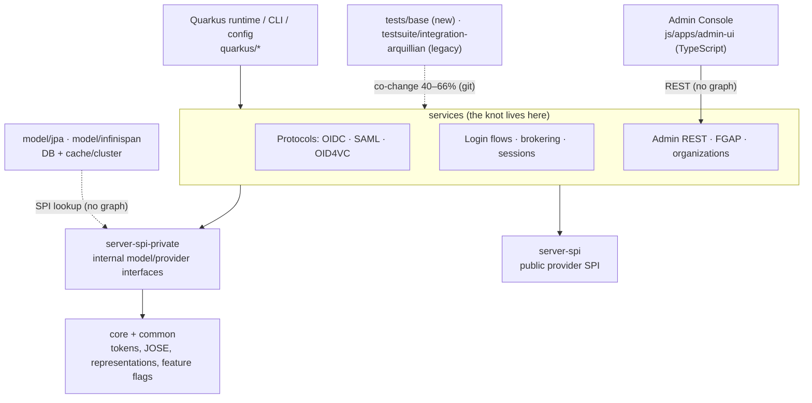

# Keycloak repo map (onboarding)

Built from three existing artifacts: [territory](artifact-1-territory.md) (git activity), [structure](artifact-2-structure.md) (jdeps graph) and [contributors](artifact-3-contributors.md) (people). The window is 2025-10-18 to 2026-10-17, at HEAD `2827b3fa10`. Detail lives in those files; this map only connects them.

## 1. TL;DR

Keycloak is an identity and access-management server. It speaks OIDC, SAML and OID4VC to applications, ships an Admin Console, and runs on Quarkus. Almost all of the logic sits in one Java module, `services`, which builds on two interface layers (`server-spi-private` → `core`) with persistence (`model/*`) and the Quarkus runtime around them. Work concentrates in `services` and in the new test framework `tests/base`, which change together most of the time (63%). This year's work was a security-hardening wave (CVE and bypass commits went from 5 to 85 per quarter) and a migration from the legacy test suite. Most new feature work went into SCIM, SSF/CAEP, organizations and OID4VC. The pain is in one 198-file runtime knot in `services` that ties together token issuance, login flows and brokering. That knot is where the security fixes land, and part of it is reachable only through browser end-to-end tests.

Solid arrows between `services`, `server-spi-private` and `core` come from the import graph. Dotted arrows come from git history or are unknown (see §3).

## 2. Territory

**Major responsibility (where the logic lives):**
- `services/src/main` (1,024 commits) holds protocol endpoints, login, brokering, admin REST, FGAP and organizations.
- `server-spi-private` and `core` are where shared types get changed. They have no life of their own: 71% and 77% of their commits also touch `services`.

**Periphery, active but self-contained:**
- `js/apps/admin-ui` (311 commits, steady): changes with `services` only 33% of the time.
- `quarkus/*` (startup, CLI, config): high churn, but contained (see §4b).
- `model/jpa` and `model/infinispan`: Q3 peak in DB work.
- Feature islands with their own tests: `scim/*` (model and tests co-change 79%) and `rest/admin-v2/*` (74%).

**Deep vs. shallow modules.** By Keycloak classes used, the deepest files are `TokenManager` 120, `SamlService` 111, `RealmAdminResource` 110, `AuthenticationManager` / `IdentityBrokerService` 109 and `OID4VCIssuerEndpoint` 105. These are wide files that touch many types, not thin facades. `core` JOSE is the opposite: a low change rate with many dependants.

**Where the directories don't match the real activity:**
- **Two module boundaries exist on disk but not in change behaviour.** `services`, `server-spi-private` and `core` are separate Maven modules with a clean, acyclic import direction, but most changes cut through all three at once. Treat them as one unit of change.
- **The two test suites are one unit right now.** `tests/base` and `testsuite/integration-arquillian` co-change at 40% because of the migration campaign. Both are touched in the same commit, even though they look like separate trees.
- **Product areas don't map to directories.** Organizations live in `services/.../organization`, but they reach into token issuance (`OrganizationScope` ↔ `TokenManager`). FGAP is split between `server-spi-private/.../authorization/fgap` and `services/.../resources/admin/fgap`.
- **Feature flags for every area sit in one file outside all of them:** `common/.../Profile.java`.

**Activity over time (Q1 → Q4):**
- Growing: SCIM (0→52), SSF/CAEP (0→43), LDAP (small base), organizations.
- Fading: workflows (57→11, done) and Admin API v2 (peaked in Q2).
- Seasonal (Q3 peak): OID4VC and DB/JPA.
- Q4 spike: broker/IdP security fixes.
- AI-assisted commits went from 0% to about 12% by Q4. That is a lower bound, because it relies on commit trailers.

## 3. Real connections

How each coupling is known: **[graph]** = jdeps/bytecode import graph; **[git]** = co-change in history; **[regen]** = changes because a build regenerates it, which is cheap; **[none]** = no graph exists for this layer, so it is *unknown*, not "no connections".

| Coupling | Evidence | What it means |
|---|---|---|
| `services` → `server-spi-private` → `core`, never back | [graph] 6,000+ edges, 0 cross-module cycles | The layering is real at compile time |
| …yet they co-change 71% / 77% | [git] | Changes ripple through shared types and representations, not through cycles |
| 198-file runtime knot in `services` (346 files counting type references) | [graph] | Token, login, broker, FGAP and org code can't be changed in isolation |
| `AuthenticationManager` has a runtime loop with each of the other four hubs | [graph], see [knot.svg](knot.svg) | The centre of the knot. `Urls` and `UserSessionUtil` are the cheapest cuts |
| Package cycle group of 21 packages in `services` | [graph] | Same knot, seen at package level |
| FGAP: 17-file SCC in `server-spi-private`, `MgmtPermissions` ↔ 7 `*Permissions` | [graph] | Permission evaluation is one tangled unit |
| `services` ↔ `tests/base` 63%, ↔ legacy suite 62% | [git] | Tests are written together with the code (healthy) |
| `tests/base` ↔ arquillian 40% | [git] | Migration lockstep (temporary) |
| `js/apps/admin-ui` ↔ `services` 33% | [git] only. **[none]** for TypeScript: no import graph was built | Coupling goes through REST; how deep it goes is unknown |
| `rest/admin-v2` → `js/libs/keycloak-admin-client/openapi.json` → TS client | **[regen]**: the Maven build in `rest/admin-v2/services/pom.xml` copies `openapi.json` into the JS lib (10 commits this year), and Kiota generates `src/generated` (not committed) | Cheap: rebuild, don't hand-edit |
| Admin UI `messages_en.properties` → ~40 locale files | **[regen]**-like: Weblate bot (54 commits). Only the English file is hand-edited (153 edits) | Translations cost nothing to the author |
| `quarkus/config-api` ↔ `quarkus/runtime` 92% | [git]. 35 of 55 config-api commits also update CLI help `*.approved.txt` | Partly build-enforced (approval tests), see §4b |
| `model/*`, `federation`, `quarkus`, `scim`, `rest/admin-v2` internals | **[none]**: outside the jdeps scope | Unknown. Only the git pairs above are known |
| Provider lookups (`session.getProvider(...)`) | **[none]**: reflection/SPI, invisible to jdeps | Real coupling is *higher* than the graph shows |

## 4. Risk zones

Each zone has at least two independent signals: structure (S), git activity or fixes (G), test reach (T), people (P), or upstream bug count (B).

1. **Token issuance and sessions.** Everything that hands an app an access or refresh token. `services/src/main/java/org/keycloak/protocol/oidc/TokenManager.java`, `.../protocol/oidc/OIDCLoginProtocol.java`, `.../services/util/UserSessionUtil.java`.
   *Why:* it is the biggest hub (S: 120 classes, in the knot) and the top target for security fixes (G: 53 commits, 11 security fixes; B: 28 open `area/oidc` bugs).
2. **Login and authentication flows.** The login page, required actions, password reset and consent. `services/src/main/java/org/keycloak/services/managers/AuthenticationManager.java`, `.../authentication/AuthenticationProcessor.java`, `.../services/resources/LoginActionsService.java`.
   *Why:* this is the core of the knot (S: 12 runtime 2-cycles, `AuthenticationManager` makes 70 session calls), and it is reachable only through browser end-to-end tests (T: 0 `tests/base` references for `LoginActionsService` / `AuthenticationProcessor`).
3. **Login via external identity providers (Google, SAML IdPs, brokering).** `services/src/main/java/org/keycloak/services/resources/IdentityBrokerService.java`, `.../broker/saml/SAMLEndpoint.java`.
   *Why:* there was a security spike in Q4 (G: 80 commits, up from 38), it is inside the knot (S: loops with `AuthenticationManager` and `TokenManager`), only one `tests/base` file mentions it (T), and there are 17 open bugs (B).
4. **Admin permissions (who may see or change what).** `server-spi-private/src/main/java/org/keycloak/authorization/fgap/AdminPermissionsSchema.java`, `services/src/main/java/org/keycloak/services/resources/admin/fgap/MgmtPermissions.java`.
   *Why:* there is a steady stream of bypass and information-disclosure fixes (G: 9+ security fixes), a 17-file SCC (S), no test names `MgmtPermissions` (T), and the knowledge sits with two people (P).
5. **Organizations (multi-tenant membership, org-scoped login).** `services/src/main/java/org/keycloak/organization/utils/Organizations.java`, `.../organization/protocol/mappers/oidc/OrganizationScope.java`.
   *Why:* an org change can alter issued tokens (S: runtime cycle with `TokenManager`), the area is growing (G: 15→55 per quarter), and it keeps getting security fixes for invitations and email verification (G).

Five zones, not six: no sixth area had two independent signals.

### 4b. Looks dangerous, but isn't

- **Quarkus/CLI/config (38% fix share, 92% coupling).** One cause, counted once: a `fix:` commit-prefix habit (90 of 103 "fixes" are refinements) plus a build-enforced approval-test workflow that updates help snapshots with every option change. Only 3 reverts.
- **`OID4VCIssuerEndpoint`, the #1 file (77 commits).** It is not in any runtime cycle and 19 `tests/base` files exercise it. The churn is feature and spec work. The one real risk is people: the top author has been inactive since July.
- **Root `pom.xml`, `.github/workflows/ci.yml`, `js/pnpm-lock.yaml`.** "Common denominators" because of dependency upgrades (Dependabot) and CI tuning, not logic.
- **`common/.../Profile.java` (57 commits).** Feature flags as code. Each promotion is a one-line edit.
- **`messages_en.properties` plus the locale files.** Bot-driven translations (see §3).
- **Legacy and new test suites changing together.** A planned migration, not entanglement.
- **Admin UI (25% fix share, 30 open bugs).** The fixes are small UI issues and E2E flakiness, and the coupling to the backend is low. This is a real backlog, but not structural risk.
- **`DefaultClientService.java`.** A top-10 file that was deleted on 2026-09-18 (#52304). Ignore it.
- **Build artifacts.** Java has no `dist` here. The only generated source is `ServicesLogger_$logger`.

## 5. Whom to ask

Check availability first: this list is based on commit counts, not org charts.

| Zone | Ask | Note |
|---|---|---|
| Token issuance and sessions | Marek Posolda (token/session internals, JOSE); Giuseppe Graziano (token exchange) | Ricardo Martin for client policies and scopes |
| Login and auth flows | Ricardo Martin (flows, brute force, session limits); Pedro Ruivo (auth-session hardening) | |
| External IdP login | Stefan Guilhen; Giuseppe Graziano | |
| Admin permissions | Pedro Igor; Vlasta Ramik | Ryan Emerson (AuthZEN) inactive since Jul 2026 |
| Organizations | Vlasta Ramik; Martin Kanis (security) | |
| Test migration (not a zone, but you'll hit it) | Stian Thorgersen | |

The best general first contacts are Stefan Guilhen (4 areas), Vlasta Ramik and Pedro Igor (3 each).

## 6. First day: read in this order

1. `common/src/main/java/org/keycloak/common/Profile.java`: every feature and its maturity. It tells you what is supported, preview or experimental.
2. `services/src/main/java/org/keycloak/services/resources/RealmsResource.java`: the public HTTP entry point. Follow it to the protocol and login endpoints.
3. `services/src/main/java/org/keycloak/protocol/oidc/OIDCLoginProtocol.java`, then `services/src/main/java/org/keycloak/protocol/oidc/TokenManager.java`: how a login becomes a token.
4. `services/src/main/java/org/keycloak/authentication/AuthenticationProcessor.java`: how flows and authenticators run.
5. `services/src/main/java/org/keycloak/services/managers/AuthenticationManager.java`: sessions, cookies and logout. The centre of the knot (open [knot.svg](knot.svg) alongside).
6. `services/src/main/java/org/keycloak/services/resources/LoginActionsService.java`: browser-side login actions.
7. `services/src/test/java/org/keycloak/protocol/oidc/TokenManagerTest.java`, then any test in `tests/base/src/test/java/org/keycloak/tests/oauth/`: how the codebase is tested without mocks, and how the new framework is used.

## 7. Limitations

- **Time window:** 12 months (2025-10-18 to 2026-10-17). Older hotspots that went quiet don't show up.
- **Method:**
  - Git counts exclude bots, mass commits (more than 150 files) and noise paths: lockfiles, `.properties`, yaml/json/xml/md, docs and test resources.
  - Areas come from path regexes, and "fix" and "security" come from subject keywords. Both are approximate.
  - The import graph covers **only** `services`, `core` and `server-spi-private`.
- **The map does NOT tell you:**
  - Anything about dependencies in `model/*`, `quarkus/*`, `federation`, `scim`, `rest/admin-v2`, or any of the TypeScript in `js/`. There is no graph for these layers, so their internal coupling is unknown.
  - Coupling through SPI/provider lookups or reflection.
  - Runtime behaviour, performance or production incidents.
  - Line-level ownership, or whether people are still on the project (departures weren't checked).
  - Whether any risk zone actually has a bug today. It shows where risk is likely, not where defects are.
- **Can't be regenerated from this folder:** the scripts behind artifact 2 were deleted, so treat its numbers as a snapshot.
